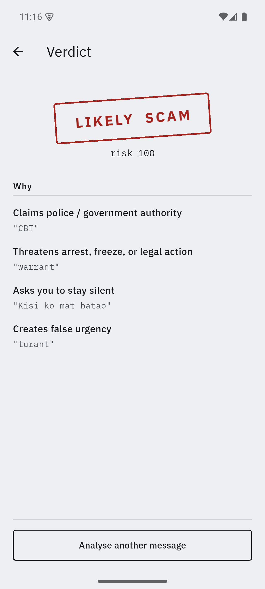
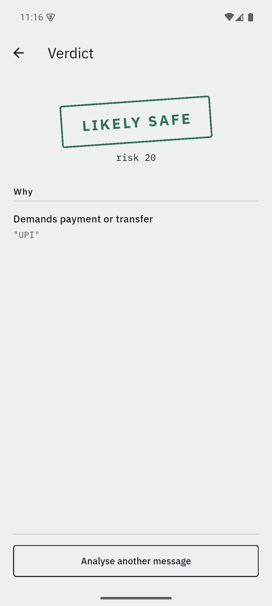

# Nazar (नज़र)

**An offline scam-message detector for Android. No internet permission, by design.**


Nazar reads an SMS or pasted message and stamps a verdict on it — SAFE, SUSPICIOUS, or LIKELY SCAM — entirely on-device, in under 50ms, with zero network calls.

<p align="center">
  
  &nbsp;&nbsp;
  
</p>

## Why this can't be a cloud API

Two reasons, both non-negotiable for this use case:

- **Privacy.** The messages this app analyses are, by definition, the ones people are most afraid to show anyone — arrest threats, KYC demands, bank fraud. Sending that text to a server to get scored defeats the purpose of a scam-protection tool.
- **Latency and availability.** The moment someone needs this most is mid-call, with a scammer pressuring them to act "immediately." A round trip to a server — or worse, no signal at all in that moment — is the difference between a warning that arrives in time and one that doesn't.

So the constraint isn't "we chose not to call the network." It's structural.

## Proof: no INTERNET permission

```xml
<!-- android/app/src/main/AndroidManifest.xml -->
<!-- No android.permission.INTERNET. This is deliberate and load-bearing. -->
<uses-permission android:name="android.permission.RECEIVE_SMS"/>
<uses-permission android:name="android.permission.READ_SMS"/>
```

Open the manifest yourself — or check the merged manifest after a release build:

```bash
flutter build apk --release
unzip -p build/app/outputs/flutter-apk/app-release.apk AndroidManifest.xml | grep -i internet
# (no output — the permission is not present)
```

This isn't "runs fine in airplane mode." It's "cannot reach the network even if it tried."

## Architecture

```
┌─────────────────────────────────────────────┐
│                    UI layer                  │
│   HomeScreen → VerdictScreen (+ History)     │
└───────────────────────┬───────────────────────┘
                         │ String text
                         ▼
┌─────────────────────────────────────────────┐
│           ScamAnalyzer  (interface)          │
│                                               │
│  RuleBasedAnalyzer  ← current build           │
│  HybridAnalyzer     ← planned (rules pre-     │
│                        filter, Gemma reasons  │
│                        over survivors)        │
└───────────────────────┬───────────────────────┘
                         │
                         ▼
┌─────────────────────────────────────────────┐
│   Detectors (8 signals, EN/Hinglish/Tanglish) │
│   → Scorer (weighted + co-occurrence combos)  │
│   → Verdict (score, band, evidence spans)     │
└─────────────────────────────────────────────┘
```

`lib/engine/` has no Flutter imports — it's plain, unit-testable Dart. The `ScamAnalyzer` interface is the seam: a `HybridAnalyzer` can be swapped in that pre-filters with these same rules and hands survivors to an on-device Gemma model, without touching the UI or the `Verdict` type anything downstream depends on.

### The scoring model

A flat weighted sum of keyword hits is weak — anyone can flag everything as a scam by counting matches. Fraud lives in **co-occurrence**: authority + urgency + payment is the fingerprint of the "digital arrest" pattern that dominates Indian voice/SMS fraud right now; any one signal alone is just noise (a real bank OTP mentions urgency; a legitimate notice can mention money). The scorer detects known combination triads and applies a multiplier on top of the base weighted score — see `lib/engine/scorer.dart` for the full reasoning and the multiplier table.

## How to run

```bash
flutter pub get
flutter run
```

## Tests

```bash
flutter test
```

`test/corpus_test.dart` runs a 30-message labelled corpus: 15 scams (digital arrest, KYC expiry, courier/customs seizure, lottery, fake refund, OTP harvest — English, Hinglish, and Tanglish variants) and 15 legitimate messages (real bank debit alerts, genuine OTPs, delivery notifications, appointment reminders). The harder and more meaningful assertion is on the legitimate set: proving real HDFC/ICICI/SBI-style alerts score under 30, not just that scams score high. This is a regression corpus, not a benchmark — 30 labelled messages don't support an accuracy percentage claim.

```
00:00 +29: legitimate messages should score under 30 (no false positives) work meeting
00:00 +30: All tests passed!
```

All 15 scam messages score ≥30 (suspicious or likely-scam) and all 15 legitimate messages score under 30 — zero false positives on the legitimate set.

## Verified: no INTERNET permission in the release build

```bash
flutter build apk --release
aapt dump permissions build/app/outputs/flutter-apk/app-release.apk
```

```
package: com.nazar.nazar
permission: com.nazar.nazar.DYNAMIC_RECEIVER_NOT_EXPORTED_PERMISSION
uses-permission: name='com.nazar.nazar.DYNAMIC_RECEIVER_NOT_EXPORTED_PERMISSION'
```

That's it — no `android.permission.INTERNET` anywhere in the merged manifest of the actual release APK, not just the source manifest. `DYNAMIC_RECEIVER_NOT_EXPORTED_PERMISSION` is a self-defined, Android-internal broadcast-receiver permission with no relation to network access.

## Roadmap

- **Whisper** for live call transcription (replacing paste-only input)
- **Gemma**, quantised and running on the NPU, reasoning over messages the rule engine flags as ambiguous — via the `HybridAnalyzer` stub already in `lib/engine/analyzer.dart`
- Tamil / Hindi voice output for verdicts
- Call-screen overlay
- Office Kit model sideload

The current build is fully on-device with no network capability. It does not yet run a model on the NPU; that arrives with the Gemma-based `HybridAnalyzer` above.
